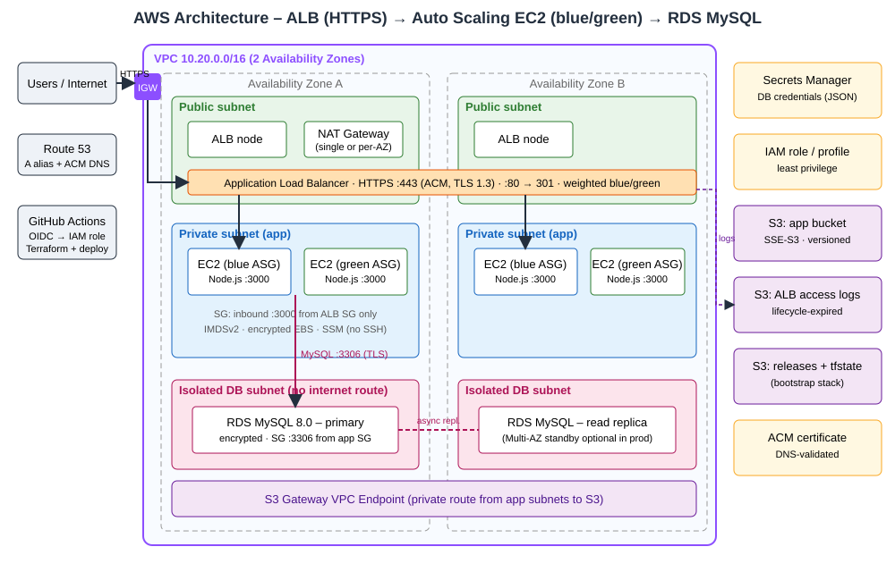
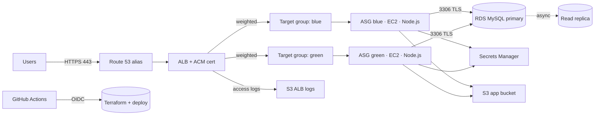

# Architecture & Design Decisions

## Network
| Tier | Subnets | Internet path |
|---|---|---|
| Public | 2 (one per AZ) | Internet Gateway; hosts ALB + NAT |
| Private (app) | 2 | Outbound only via NAT; S3 via free gateway endpoint |
| Database | 2 | **None** – no route to IGW/NAT |

## Security controls
| Requirement | Implementation |
|---|---|
| Encryption at rest | RDS `storage_encrypted`, EBS `encrypted`, S3 SSE-S3, Secrets Manager (KMS) |
| HTTPS only | ALB :443 with ACM cert + TLS 1.3 policy; :80 only returns 301; S3 buckets deny non-TLS |
| Secrets | Random 24-char DB password generated by Terraform, stored only in Secrets Manager; app reads it at runtime through its IAM role – never in user-data, env files or git |
| Least-privilege IAM | Instance role: read one secret, read `releases/*`, access one app bucket, SSM core. CI role: scoped to project-named resources via OIDC, trust limited to your repo |
| Security groups | ALB: 80/443 in → app only; App: 3000 from ALB SG only; DB: 3306 from app SG only (no CIDR rules) |
| Host hardening | IMDSv2 required, no SSH/port 22 (use SSM Session Manager), systemd sandboxing |
| DB in private subnets | Isolated DB subnets, `publicly_accessible = false`, TLS verified with the RDS CA bundle |

## High availability
ALB and subnets span 2 AZs; ASG spreads instances across both (min 2). RDS Multi-AZ is a flag (`db_multi_az`, on in prod); NAT per AZ via `single_nat_gateway = false` (prod).

## Blue/green
Two ASGs + two target groups, both always attached to the HTTPS listener (idle weight = 0). `scripts/bluegreen.sh`:
1. Build the **idle** colour with the new version (Terraform waits for healthy ALB targets).
2. Switch the listener to the new colour (`active_color`).
3. Smoke-test `https://<domain>/api/status` (colour + version + DB). On failure, traffic is switched back automatically.
4. Scale the old colour to zero (or keep as warm standby). **Rollback** = run the workflow with `action=rollback`.
`canary_weight` (0-100) can send a % of traffic to the idle colour for a canary step.

## Cost notes (free-tier-aware)
Free-tier eligible: `t3.micro` EC2, `db.t3.micro` 20 GB single-AZ RDS, S3 gateway endpoint, Secrets Manager trial.
**Not free:** NAT Gateway (~$0.045/hr + data), ALB, the read replica, 2nd running fleet during cut-over. Run `destroy` when you are done.
